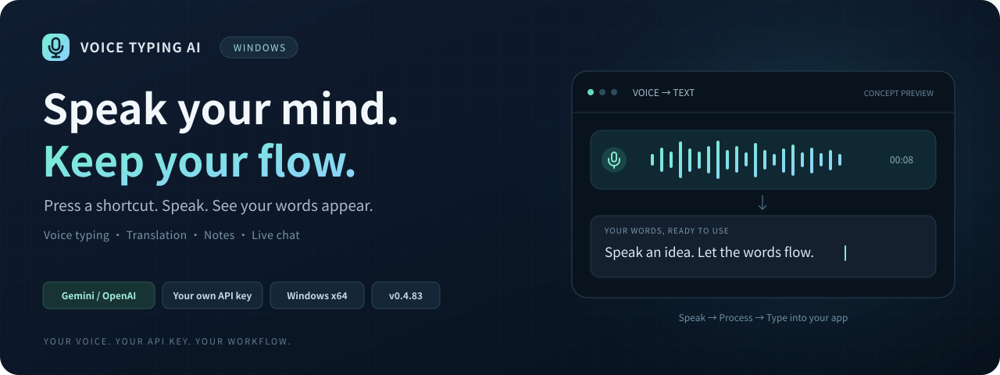

<p align="center">
  
</p>

<h1 align="center">Voice Typing AI for Windows</h1>

<p align="center"><strong>用快捷键开始说话，把想法写进当前输入框。</strong></p>
<p align="center">Windows x64 · 0.4.83 · Gemini / OpenAI · 自备 API Key</p>

<p align="center">
  <a href="https://github.com/silkykorea-blip/VoiceTypingAI-Windows/releases/tag/v0.4.83"><strong>下载 Windows 版</strong></a>
  &nbsp;·&nbsp; <a href="#开始使用">开始使用</a>
  &nbsp;·&nbsp; <a href="#默认快捷键">快捷键</a>
  &nbsp;·&nbsp; <a href="#隐私与本地数据">隐私说明</a>
  &nbsp;·&nbsp; <a href="#android-版本">Android 版</a>
</p>

---

Voice Typing AI 是一个 Windows 桌面语音工具：在输入框中听写、把口述内容翻译成目标语言、记录笔记，也可以打开独立窗口进行有语音回复的实时对话。通过全局快捷键启动，减少在应用之间切换。

**Windows 版采用 BYOK（Bring Your Own Key）：需要自行填写 Gemini 或 OpenAI API Key。** 仓库及发行包不内置开发者的密钥，也不提供随软件附送的云端额度。识别与对话需要联网；费用、额度、模型权限和服务可用性由所选供应商决定。

## 下载与安装

当前公开版本：**0.4.83**。从 [GitHub Release](https://github.com/silkykorea-blip/VoiceTypingAI-Windows/releases/tag/v0.4.83) 下载，选择一种运行方式即可。

| 版本 | 下载 | 适用方式 |
| --- | --- | --- |
| 安装版 | [VoiceTypingAI-v0.4.83-setup.exe](https://github.com/silkykorea-blip/VoiceTypingAI-Windows/releases/download/v0.4.83/VoiceTypingAI-v0.4.83-setup.exe) | 安装到当前用户目录，创建桌面与开始菜单快捷方式 |
| 便携版 | [VoiceTypingAI-v0.4.83-portable.exe](https://github.com/silkykorea-blip/VoiceTypingAI-Windows/releases/download/v0.4.83/VoiceTypingAI-v0.4.83-portable.exe) | 保存到可写目录，直接运行 EXE |
| 文件校验 | [SHA256SUMS.txt](https://github.com/silkykorea-blip/VoiceTypingAI-Windows/releases/download/v0.4.83/SHA256SUMS.txt) | 核对下载文件的 SHA-256 |

运行环境为 **Windows x64、.NET Framework 4.x、可用麦克风和网络连接**。本项目当前构建使用 Windows 自带的 .NET Framework 编译器；如系统缺少运行环境，可参考 [Microsoft .NET Framework 安装说明](https://learn.microsoft.com/dotnet/framework/install/)。

安装版的程序位置是 `%LOCALAPPDATA%\VoiceTypingAI`。便携版可以直接运行，但设置、历史记录等仍会写入 Windows 用户数据目录；它并非把所有数据都保存在 EXE 旁边。

<details>
<summary>如何核对下载文件</summary>

在下载目录打开 PowerShell，执行：

```powershell
Get-FileHash .\VoiceTypingAI-v0.4.83-setup.exe -Algorithm SHA256
Get-FileHash .\VoiceTypingAI-v0.4.83-portable.exe -Algorithm SHA256
```

将结果与同一 Release 中的 `SHA256SUMS.txt` 对照。只需校验自己下载的版本。

</details>

## 可以做什么

| 功能 | 使用方式 |
| --- | --- |
| **语音输入** | 在可编辑输入框中启动录音，将识别结果输入到目标位置；自动输入不可用时可检查剪贴板并手动粘贴 |
| **翻译输入** | 口述后输出所选目标语言的文本，默认目标语言为 English |
| **Notes 记事** | 用独立快捷键记录内容，在记事浮窗查看与管理 |
| **实时语音聊天** | 与所选供应商进行语音对话，接收文字与语音回复；提供 3 个独立聊天页，可改标题、清空当前页 |
| **日程与备忘** | 在实时对话中明确请求新增或读取本地日程、备忘，并在 Notes 中查看相关内容 |
| **浮窗与个性设置** | 调整快捷键、显示记事/聊天浮窗、置顶及 Alt+Tab 显示方式；Gemini 聊天的联网搜索开关默认关闭 |

设置页提供 **31 个明确的语言/地区选项及 System 选项**，翻译目标提供 31 个选项。它们是界面可选项，不代表所有语言在每个供应商上的识别表现相同。

当前普通语音输入和翻译输入的单次录音有 **3 分钟自动结束上限**。识别延迟和结果质量会受到麦克风、环境噪声、网络、供应商模型及账户额度影响。

## 开始使用

### 1. 配置自己的 API Key

打开应用设置，选择 **Gemini** 或 **OpenAI**，填写对应的 API Key 并保存。当前各功能使用设置中选择的供应商及其对应密钥。

| 供应商 | 官方设置指引 |
| --- | --- |
| Gemini | [获取与管理 Gemini API Key](https://ai.google.dev/gemini-api/docs/api-key) |
| OpenAI | [获取与管理 OpenAI API Key](https://help.openai.com/en/articles/4936850-where-do-i-find-my-op) |

使用前请确认密钥有权访问本版本所需的 API 和模型，并检查账户额度。**BYOK 不等于免费云服务**；软件无法代替供应商保证模型权限或持续可用性。

### 2. 先完成一次语音输入

1. 在 Windows 中选好默认输入麦克风，并允许桌面应用访问麦克风。
2. 打开记事本或其他普通可编辑输入框，把光标放到要输入的位置。
3. **按一下右 Alt 开始录音**，说完后**再按一下右 Alt 停止并提交**，无需一直按住。
4. 等待处理完成，检查文字；如没有自动输入，先查看剪贴板，再尝试 `Ctrl + V`。

录音过程中尽量保持目标输入框和焦点稳定。密码框、受保护控件或不同权限级别的程序，可能拒绝自动输入。

### 3. 使用翻译、记事与聊天

- **翻译**：先在设置中选择目标语言，再用翻译快捷键开始和结束录音。
- **记事**：用 Notes 快捷键开始和结束录音，在记事浮窗查看结果。
- **聊天**：用实时聊天快捷键开始会话，再次按下结束会话；在聊天窗口选择需要使用的页面。

## 默认快捷键

| 按键 | 动作 |
| --- | --- |
| **右 Alt** | 开始 / 停止普通语音输入 |
| **Scroll Lock** | 开始 / 停止翻译输入 |
| **右 Alt + 空格** | 开始 / 停止 Notes 语音记事 |
| **右 Alt + 右 Ctrl** | 开始 / 结束实时语音聊天 |
| **Pause / Break** | 显示 / 隐藏浮窗 |

这些按键均可在设置页调整。笔记本如果没有独立的 Scroll Lock 或 Pause / Break 键，可以选择其他组合；发生快捷键冲突时，也请先在设置中更换。

## 隐私与本地数据

完整说明见 [Windows 隐私说明](docs/PRIVACY.zh-CN.md)。

### 数据如何处理

- **云端处理**：识别、翻译和实时对话所需的音频、文本及上下文会发送给所选 AI 供应商；密钥用于向该供应商鉴权。处理与保留规则以供应商政策为准。
- **本地密钥**：保存的 API Key 使用 Windows DPAPI 的 `CurrentUser` 范围加密，绑定当前 Windows 用户。不要把配置文件当成可公开分享的普通文件。
- **本地内容**：笔记、聊天历史、日程、备忘、日志和音频可能保留在电脑上。当你在实时对话中请求读取日程或备忘时，相关内容也会用于供应商会话。
- **剪贴板**：识别结果可能写入 Windows 剪贴板，供自动输入或手动粘贴使用。

### 0.4.83 会保留什么

**当前版本会自动保存处理后的输入录音，也可能留下临时录音；没有供用户关闭录音归档的界面开关，也没有录音的自动到期清理机制。** 请按自己的隐私需求管理这些文件，尤其是在共享电脑上使用时。

| 数据 | 常见位置 |
| --- | --- |
| 设置与加密后的 API Key | `%APPDATA%\VoiceTypingAI\settings.ini` |
| 记事、无日期备忘与部分窗口状态 | `%APPDATA%\VoiceTypingAI\widgets.json` |
| 日程及兼容的旧备忘 | `%APPDATA%\VoiceTypingAI\schedules.json` |
| 实时聊天历史 | `%APPDATA%\VoiceTypingAI\realtime-conversations.json` |
| 调试日志与诊断内容 | `%APPDATA%\VoiceTypingAI\debug.log`、`debug.log.1`、`diagnostics\` |
| 浮窗布局 | `%LOCALAPPDATA%\VoiceTypingAI\widget-layout.ini` |
| 处理后录音 | `processed-audio\`，位置选择规则见下方 |
| 最近一次录音副本 | `%TEMP%\voice-typing-ai-last-recording.wav` |
| 其他临时录音 | `%TEMP%\voice-typing-ai-*.wav` |

设置与历史文件还可能有 `.bak` 备份。`processed-audio` 优先使用环境变量 `VOICE_TYPING_AI_PROCESSED_AUDIO_DIR` 指定的目录；未指定时依次尝试检测到的项目目录、EXE 所在目录，以及 `%LOCALAPPDATA%\VoiceTypingAI\processed-audio`。日志位置也可以被 `VOICE_TYPING_AI_DEBUG_LOG_PATH` 覆盖。

清理前先退出应用，并保留自己仍需要的笔记或日程。清空聊天页面、删除 EXE 或下载新的发行包，不应被视为已清除上述全部数据。历史版本用户还可以检查旧的 `generated-audio` 语音回复归档目录。

**本次源码公开前已移除开发时的真实录音、转写原文、日志与实验输出。** 这项清理没有改变应用的自动归档行为；从源码运行后仍可能重新生成敏感文件。提交代码、上传问题附件或分享整个文件夹前，请再次检查。

## 常见问题

| 现象 | 建议检查 |
| --- | --- |
| 提示密钥无效、无权限或额度不足 | 供应商选择是否正确、密钥是否完整、账户权限与额度是否满足本版本配置的模型 |
| 正在录音但没有声音 | Windows 默认输入设备、麦克风权限、静音状态和输入音量；可先用 Windows 录音工具确认设备 |
| 有识别结果，但没有出现在目标输入框 | 光标是否仍在原输入框、目标是否可编辑；查看剪贴板后手动粘贴，并检查目标程序的权限级别 |
| 快捷键没反应 | 是否使用了默认的**右侧** Alt / Ctrl、按键是否被其他软件占用；尝试在设置中换一组快捷键 |
| 停止后等待很久或请求失败 | 网络连通性、供应商状态、配额与模型权限；先用短语音确认链路，不要把重试视为一定不会产生额外 API 用量 |
| 找不到记事或聊天浮窗 | 检查设置中的显示开关，或使用 Pause / Break / 自定义浮窗快捷键 |
| 换电脑后密钥不能直接使用 | 密钥保护绑定 Windows 用户；在新环境重新打开设置并填写自己的密钥 |
| 下载后无法启动 | 确认是 Windows x64、文件完整，并检查 .NET Framework 运行环境；仅从本仓库 Release 获取文件 |

如果需要反馈问题，请在 [Issues](https://github.com/silkykorea-blip/VoiceTypingAI-Windows/issues) 中说明版本、Windows 环境、所选供应商和复现步骤。**不要提交 API Key、完整用户配置、真实录音或未经检查的聊天/调试日志。**

## 从源码构建

本仓库包含 **Windows 版本的 C# / WinForms 源码**。当前构建直接调用 Windows .NET Framework 的编译器及系统程序集，不依赖 Node.js、Python 或在线 NuGet 还原。

在项目根目录打开 PowerShell：

```powershell
powershell -NoProfile -ExecutionPolicy Bypass -File .\build.ps1
```

| 输出 | 用途 |
| --- | --- |
| `bin\VoiceTypingAI.exe` | Windows x64 应用 |
| `dist\VoiceTypingAISetup.exe` | 安装程序 |

构建脚本使用标准 Windows 安装路径下的 `Framework64\v4.0.30319\csc.exe`，并引用 WPF 的 UI Automation 程序集。这里的 `v4.0.30319` 是工具目录名称，不应据此推断已验证所有旧版 Windows 或所有 .NET Framework 4.x 环境。

<details>
<summary>源码入口</summary>

| 文件 / 目录 | 内容 |
| --- | --- |
| [`Program.cs`](Program.cs) | 主界面、语音输入、设置、音频流程与自动输入 |
| [`RealtimeConversation.cs`](RealtimeConversation.cs) | 独立聊天页面与会话存储 |
| [`WakeAndConversation.cs`](WakeAndConversation.cs) | 语音会话与供应商通信；文件名包含历史命名 |
| [`FeatureLocalization.cs`](FeatureLocalization.cs) | 功能界面本地化 |
| [`installer/`](installer/) | 安装器与安装相关文件 |
| [`tests/`](tests/) | 离线回归与供应商测试工具 |
| [`build.ps1`](build.ps1) | 应用及安装程序的构建入口 |

</details>

## 测试与验证范围

运行离线回归：

```powershell
powershell -NoProfile -ExecutionPolicy Bypass -File .\tests\build-and-run-tests.ps1
```

本次公开前的本地检查结果为：**构建通过，离线回归 132 / 132 通过。** 测试脚本随后会编译 `ProviderSmokeTests.exe`，但不会自动执行真实供应商调用。

离线测试用于检查本地逻辑，不能代替所有真实麦克风、蓝牙设备、目标输入框、管理员权限场景和供应商 API 的实测。本次检查也不保证云端模型今后的可用性。若自行运行供应商测试工具，需要准备自己的密钥和非敏感测试音频；该工具会向 Gemini 和 OpenAI 发送音频，并可能产生费用。开发时的真人测试录音不随仓库分发。

## Android 版本

<a href="https://play.google.com/store/apps/details?id=com.silkytypingai.app">
  
</a>

手机上也可以使用独立的 **Voice Typing AI - Talk to Text**：

**[在 Google Play 查看 Android 版 →](https://play.google.com/store/apps/details?id=com.silkytypingai.app)**

本仓库仅包含 Windows 版本源码。Android 版的功能、账号方式和使用条件以 Google Play 当前介绍为准；Windows 版的 BYOK 设置与功能说明不作为 Android 版的承诺。

## English overview

Voice Typing AI for Windows provides voice typing, translation input, notes, and real-time voice conversations through global shortcuts. It targets Windows x64 and uses your own Gemini or OpenAI API key. Cloud processing requires an internet connection and may incur provider charges.

Version **0.4.83** is available as an installer or a portable executable. The portable build still stores user data in Windows application-data folders. This version automatically retains processed input audio and may leave temporary recordings, logs, and conversation history; review the privacy section before use.

The repository contains the Windows source only. The Android application is a separate product linked above. No open-source license has been selected for this repository.

## 作者与授权

开发者：**SILKYKOREA**  
联系邮箱：[cuizhe699@gmail.com](mailto:cuizhe699@gmail.com)

当前暂未选择开源许可证。源码公开不等于授予任意使用、修改或再分发的许可；如需相应授权，请联系开发者。
